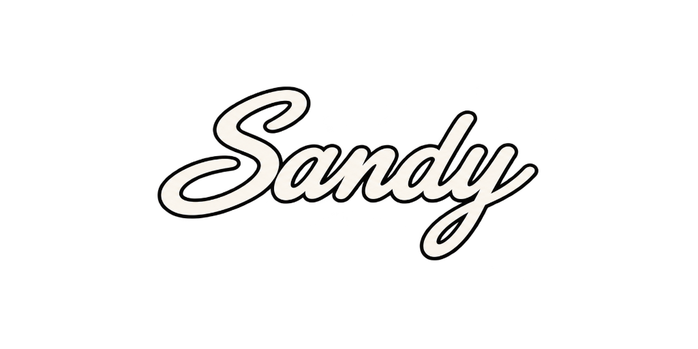
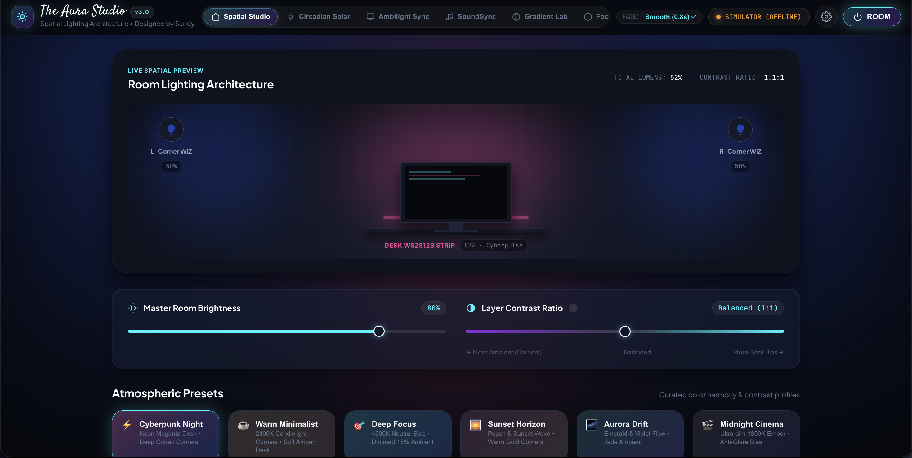
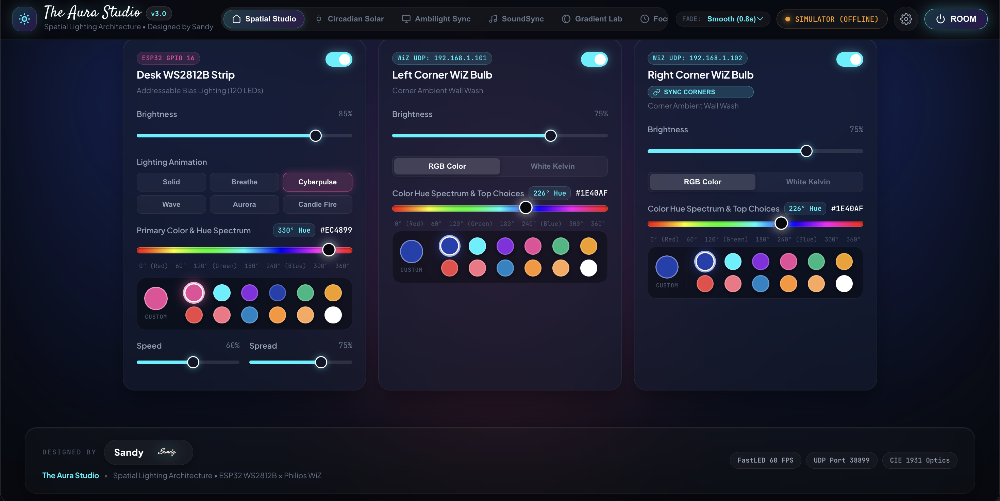
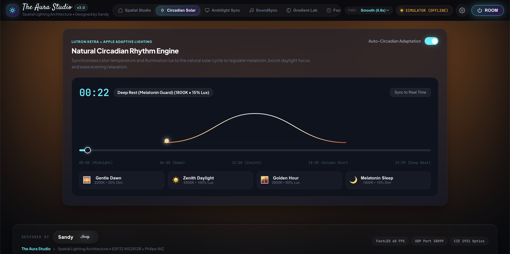
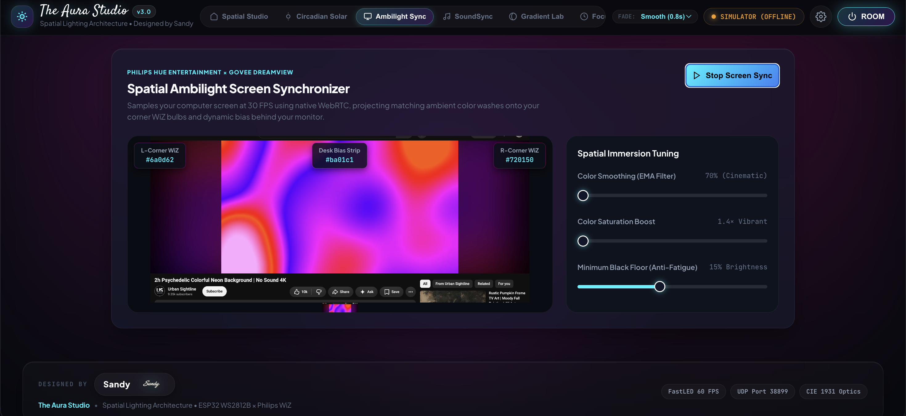
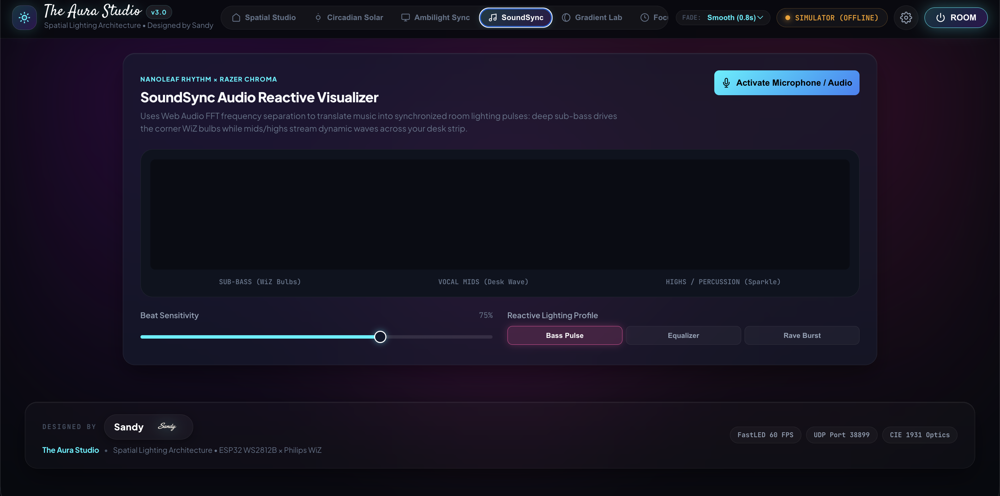
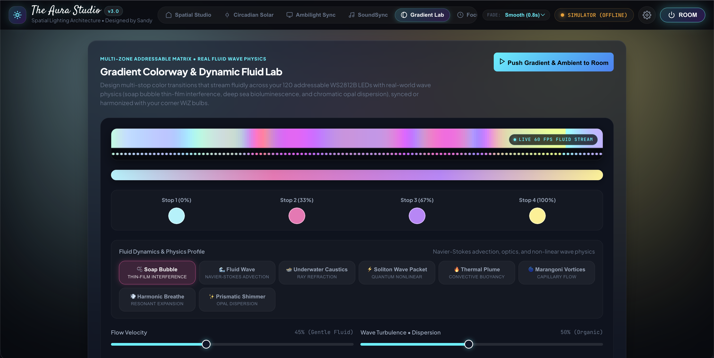
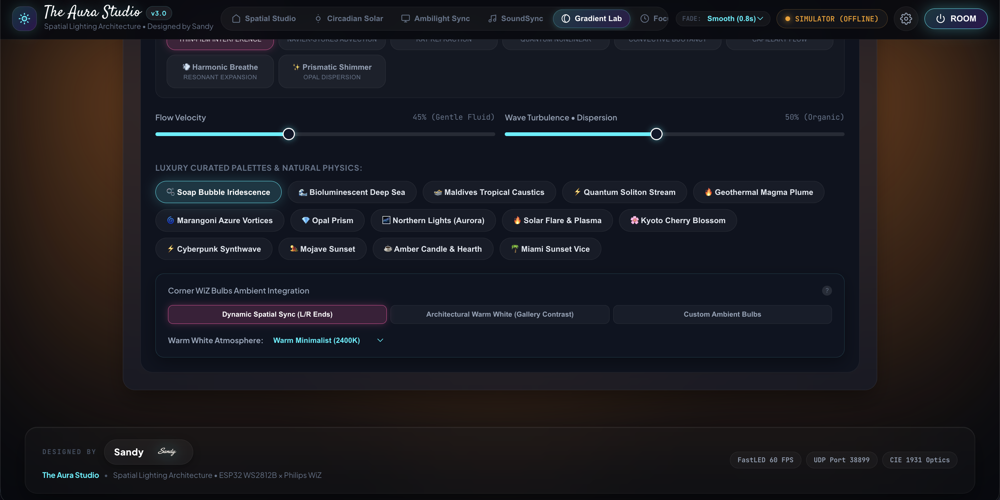
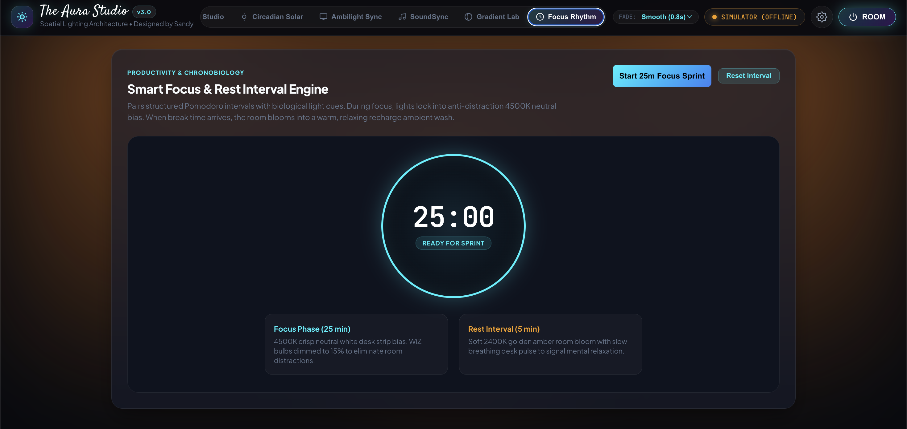

# THE AURA STUDIO - Elegant Smart Lighting Architecture

<div align="center">

# ✦ THE AURA STUDIO ✦
### Elegant Smart Lighting Architecture & Spatial Ambience Hub
**Designed by**

<br/>

<a href="https://github.com/Sandeep271958/The_Aura_Studio">
  
</a>

<br/><br/>

[](https://github.com/Sandeep271958/The_Aura_Studio)
[](https://github.com/Sandeep271958/The_Aura_Studio)
[](https://github.com/Sandeep271958/The_Aura_Studio)
[](https://github.com/Sandeep271958/The_Aura_Studio)
[](https://github.com/Sandeep271958/The_Aura_Studio)
[](https://github.com/Sandeep271958/The_Aura_Studio)

<br/>

> **A production-grade, local luxury smart lighting hub and spatial architecture controller engineered for dual Philips WiZ corner bulbs and an addressable WS2812B desktop LED strip.**
> **Zero cloud dependency. Under 10ms local UDP latency. Built with FreeRTOS dual-core firmware, real-time wave physics, and an obsidian glassmorphism spatial dashboard.**

</div>

---

## 📸 Visual Tour & Interface Showcase

The Aura Studio features a bespoke obsidian glassmorphism interface built from the ground up to rival commercial luxury systems like Lutron Ketra and Bang & Olufsen BeoLiving. Below is a complete visual walkthrough of the operational Web UI.

<div align="center">

### 1. 🏛️ Spatial Studio & Interactive 2.5D Room Architecture

*Real-time 2.5D isometric room canvas rendering live ambient wall bounce, desk monitor bias, and luxury hospitality atmospheric presets.*

<br/>

### 2. 🎛️ 3-Channel Hardware Matrix & Spectrum Scrubbing

*Independent and unified controls for Desk WS2812B Strip and dual Corner WiZ Bulbs with 360° Rainbow Hue Bars, 12-color curated palette chips, and the Designed by Sandy signature footer.*

<br/>

### 3. ☀️ Natural Circadian Rhythm Engine

*Biological 24-hour solar arc tracking based on Lutron Ketra and Apple Adaptive Lighting algorithms with live Kelvin/Lux modulation.*

<br/>

### 4. 🖥️ Spatial Ambilight Screen Synchronizer

*Native WebRTC 30 FPS display sampling projecting dynamic left, center, and right room color washes with zero companion desktop apps.*

<br/>

### 5. 🎵 SoundSync Audio Reactive Visualizer

*Web Audio API FFT frequency separation driving sub-bass room pulses across WiZ bulbs while vocal mids and highs ripple across the desk strip.*

<br/>

### 6. 🎨 Gradient Colorway & Real Fluid Wave Physics Lab

*Live 60 FPS fluid simulation canvas, 120-LED addressable pixel matrix, 4-stop linear colorway builder, and 8 Navier-Stokes & optical wave physics engines.*

<br/>

### 7. 🌌 Curated Luxury Palettes & WiZ Ambient Integration

*14 luxury designer physics palettes and intelligent WiZ integration modes (Dynamic Spatial Sync vs. Architectural Warm White Gallery Contrast).*

<br/>

### 8. ⏳ Smart Focus & Rest Interval Engine (Pomodoro Chronobiology)

*Chronobiology interval timer pairing anti-distraction 4500K task lighting with 2400K golden amber restorative bloom.*

</div>

---

## 🌟 The Concept: Layered Room Lighting Architecture

Most smart lighting setups feel harsh, distracting, or flat because single-strip setups produce harsh localized glare without diffuse room fill. **The Aura Studio** models your room as an architectural, multi-layered lighting canvas:

```
┌────────────────────────────────────────────────────────┐
│  [Corner WiZ Bulb 1]              [Corner WiZ Bulb 2]  │  <- Layer 1: Ambient Wall Fill
│         \                                /             │     (Bounces off walls, soft fill)
│          \                              /              │
│           ▼                            ▼               │
│                  ┌──────────────────┐                  │
│                  │  Monitor Display │                  │
│                  └────────┬─────────┘                  │
│                           ▼                            │
│              [ WS2812B Bias / Backlight ]              │  <- Layer 2: Contrast & Eye Bias
│             ══════════════════════════════             │     (Rich gradient behind screen)
│                    [ Desk Surface ]                    │
│                                                        │
└────────────────────────────────────────────────────────┘
```

1. **Layer 1: Ambient Wall Fill (2× Philips WiZ Corner Bulbs)**
   - Bathes perimeter walls in diffuse, indirect illumination, eliminating high-contrast shadows in peripheral vision.
2. **Layer 2: Contrast & Eye Bias Glow (Desk WS2812B Strip)**
   - Backlight situated directly behind the computer monitor to balance screen luminosity and prevent optical strain.
3. **The Layer Contrast Slider**:
   - Dynamically rebalances illumination between ambient wall bounce and monitor bias while preserving perceived overall room lux.

---

## 💎 Deep-Dive Feature Suites

The Aura Studio incorporates the most sophisticated lighting engineering found across luxury architectural installations (**Lutron Ketra**, **Philips Hue Entertainment**, **Govee DreamView**, **Nanoleaf Rhythm**, and **Apple Adaptive Lighting**):

---

### 1. 🏛️ Spatial Studio & Architectural Atmosphere Presets

<p align="center">
  
</p>

The **Spatial Studio** is the primary control deck of The Aura Studio. It centers around a live **2.5D Isometric Room Viewport** rendered on an HTML5 canvas that mirrors the physical room's lighting state in real time:
- **Real-Time Spatial Simulation:** Visualizes light emitted from the two corner WiZ bulbs and the central desk strip, simulating wall bounce, monitor reflection, and floor gradients.
- **Master Room Controls:**
  - **Master Brightness (0–100%):** Logarithmic dimming curve calibrated to human eye perception ($CIE\ 1931$).
  - **Layer Contrast Ratio (Bias vs. Ambient Fill):** Shifts illumination weight between direct desk backlight and ambient perimeter bounce without shifting overall room lux.
  - **Global Fade Transition:** Configurable fade speeds (`Instant`, `Smooth 0.8s`, `Gentle 2.0s`, `Cinematic 4.0s`).
- **World-Class Hospitality Presets:**
  1. ⚡ **Cyberpunk Night:** Neon Magenta desk (`#ec4899`) with Deep Cobalt corners (`#1e40af`) for immersive synthwave gaming.
  2. ☕ **Warm Minimalist:** 2400K Candlelight corners with soft amber desk breathe effect (`#f59e0b`).
  3. 🎯 **Deep Focus:** 4500K crisp neutral white bias with 15% dimmed ambient corners for distraction-free sprints.
  4. 🌅 **Sunset Horizon:** Golden peach & sunset wave (`#f43f5e`) with warm 2700K gold corners (`#fb923c`).
  5. 🌌 **Aurora Drift:** Emerald & violet fluid flow (`#10b981`) with jade ambient bounce (`#8b5cf6`).
  6. 🎬 **Midnight Cinema:** Ultra-dim 1800K ember with anti-glare monitor bias for cinematic viewing.
  7. 🌸 **Aman Kyoto Zen:** Serene Japanese ryokan tranquility. 2200K Sakura dawn wave (`#fbcfe8`) paired with 2000K intimate candlelight corners (`#ff8a12`).
  8. 🏛️ **Grand Welcome (Lutron Ketra):** High-end hotel arrival scene. Flattering 2800K incandescent ambient baseline with rich warm amber-gold wall wash (`#ffc078`).
  9. 🌿 **Deep Sanctuary Spa:** Nordic wellness recovery. Restorative aquamarine bioluminescent desk glow (`#0d9488`) with 2400K warm decompression wash (`#ff9b3d`).
  10. 🌊 **Oceanic Abyss:** Bioluminescent deep-sea cyan pulse (`#00f2fe`) transitioning into deep midnight cobalt corners (`#0b192c`).

---

### 2. 🎛️ 3-Channel Hardware Matrix & Spectrum Scrubbing

<p align="center">
  
</p>

Provides complete independent or coordinated mastery over all 3 lighting hardware channels:
- **Desk WS2812B Strip (120 Addressable LEDs):**
  - High-performance FastLED animation modes: `Solid Color`, `Fluid Wave`, `Breathe`, `Rainbow Flow`, `Chroma Pulse`.
  - Rate/speed slider, brightness dimming, and independent power switch.
- **Left & Right Corner WiZ Bulbs:**
  - Dual-mode operation: **Pure CCT White** (2000K Candlelight to 6500K Studio Daylight) or **Full RGB Spectrum**.
- **360° Continuous Rainbow Spectrum Hue Bar:**
  - Draggable smooth hue scrubber (`0°` to `360°`) on each channel for rapid, intuitive color dialing without OS dialogs.
- **Curated 12-Color Smart Palette Matrix:**
  - One-tap access to hand-tuned architectural hues: Cyber Magenta, Electric Cyan, Royal Violet, Deep Cobalt, Emerald Jade, Vivid Amber, Crimson Ruby, Sunset Coral, Sky Cerulean, Candlelight 2000K, Soft Warm 2700K, and Studio Daylight White.
- **Signature Branding Footer:**
  - Includes Sandy's signature product logo, hardware firmware indicators, FastLED 60 FPS telemetry, UDP port 38899 status, and CIE 1931 optical compliance tag.

---

### 3. ☀️ Natural Circadian Rhythm Engine (Human-Centric Lighting)

<p align="center">
  
</p>

Synchronizes room lighting with the biological 24-hour solar cycle to naturally regulate melatonin production, alertness, and restorative sleep:
- **Mathematical Solar Arc Model:** Computes sun elevation using sinusoidal solar harmonics:
  $$\text{Elevation}(t) = \sin\left(\frac{t - 6}{12} \times \pi\right)$$
- **Autonomous CCT & Lux Progression:**
  - **06:00 Dawn:** Gentle 2200K warm sunrise at 30% lux to stimulate natural cortisol release without glare.
  - **12:00 Zenith Noon:** 6500K daylight-balanced white at 100% lux for peak mental focus and cognitive acuity.
  - **18:00 Golden Hour:** 2800K warm incandescent glow at 60% lux signaling the end of the workday.
  - **23:00+ Deep Rest (Melatonin Guard):** 1800K ultra-warm amber at 15% lux, eliminating blue wavelengths below 480nm to protect melatonin synthesis.
- **Interactive Timeline Scrubber:** Allows immediate manual time simulation and preview across any hour of the day.

---

### 4. 🖥️ Spatial Ambilight Real-Time Screen Synchronizer

<p align="center">
  
</p>

Transforms the entire room into an expansive visual extension of your computer monitor:
- **Native WebRTC Capture:** Utilizes the browser's native `navigator.mediaDevices.getDisplayMedia` API running at 30 FPS. **Requires zero third-party software, drivers, or background daemons.**
- **3-Zone Spatial Color Extraction:**
  - **Left Screen Edge:** Extracted and dispatched to Left Corner WiZ Bulb (`#6a0d62`).
  - **Center & Bottom:** Extracted and streamed to Desk WS2812B Strip (`#ba01c1`).
  - **Right Screen Edge:** Extracted and dispatched to Right Corner WiZ Bulb (`#720150`).
- **Spatial Immersion Tuning:**
  - **Color Smoothing (EMA Filter):** Exponential Moving Average ($C_t = \alpha \cdot C_{sample} + (1-\alpha) \cdot C_{t-1}$) configurable from 10% (high-speed gaming) to 90% (cinematic movie transitions).
  - **Saturation Boost (1.0×–2.0×):** Compensates for dark letterboxing and enhances cinematic color vibrancy.
  - **Minimum Black Floor (Anti-Fatigue):** Prevents the room from abruptly snapping to pitch-black during dark movie cuts.

---

### 5. 🎵 SoundSync Audio Reactive Visualizer

<p align="center">
  
</p>

Converts music and voice into physical light dynamics using real-time Fast Fourier Transform (FFT) frequency analysis via the **Web Audio API**:
- **3-Band Frequency Separation:**
  - **Sub-Bass (20–150 Hz):** Powers deep ambient thumps on both corner WiZ bulbs, creating visceral room-filling presence.
  - **Vocal Mids (150–2500 Hz):** Drives fluid harmonic light waves across the desk strip.
  - **Highs / Percussion (2500–16000 Hz):** Triggers crisp micro-sparkles and shimmer highlights.
- **Reactive Lighting Profiles:**
  - **Bass Pulse:** Rhythmic illumination breathing to low-end transients.
  - **Equalizer:** Real-time LED strip graphic equalizer mapping frequency bins from left to right.
  - **Rave Burst:** High-energy transient strobe with dynamic hue rotation.

---

### 6. 🎨 Gradient Colorway & Real Fluid Wave Physics Lab

<p align="center">
  
</p>

<p align="center">
  
</p>

The flagship dynamic lighting laboratory. Unlike generic smart strips that shift between static colors, The Aura Studio models **real-world fluid dynamics and optical wave physics** running in a real-time 60 FPS simulation loop:
- **Live Dual-Zone Simulation:**
  - **Continuous Fluid Stream Ribbon:** Displays the uninterrupted multi-harmonic wave dispersion.
  - **120-LED Addressable Pixel Matrix:** Renders the exact interpolated color of every individual physical LED bead.
- **4-Stop Linear Colorway Designer:**
  - Customizable color stops at 0%, 33%, 67%, and 100% with real-time gradient blending.
- **8 Scientific Physics & Motion Profiles:**
  1. 🫧 **Soap Bubble (Thin-Film Optical Interference):** Models light interference on microscopic fluid membranes ($\delta = \frac{4\pi}{\lambda} d \cos\theta$) with chromatic phase splitting ($\Delta\phi_R=0, \Delta\phi_G=\frac{2\pi}{3}, \Delta\phi_B=\frac{4\pi}{3}$).
  2. 🌊 **Fluid Wave (Navier-Stokes Advection):** Fluid momentum transfer with viscous dissipation and turbulence dispersion.
  3. 🏊 **Underwater Caustics (Ray Refraction):** Optical ray convergence through dual intersecting wave surfaces.
  4. ⚡ **Soliton Wave Packets (Quantum Nonlinear):** Dual solitary waves ($A \cdot \text{sech}^2(\frac{x - vt}{w})$) that collide and pass through each other without dispersion.
  5. 🔥 **Thermal Convection Plumes (Fractal Brownian Heat):** Convective buoyant fluid rising in curling filaments.
  6. 🌀 **Marangoni Surface Vortices (Capillary Flow):** Surface tension gradient-driven flow creating 4 counter-rotating cellular convection rolls.
  7. 💨 **Harmonic Breathing (Resonant Expansion):** Symmetric expansion and contraction from center bias.
  8. ✨ **Prismatic Opal Shimmer (Scintillation):** High-frequency micro-refraction dispersion sparkle.
- **14 Luxury Curated Designer Palettes:**
  - *Soap Bubble Iridescence*, *Bioluminescent Deep Sea*, *Maldives Tropical Caustics*, *Quantum Soliton Stream*, *Geothermal Magma Plume*, *Marangoni Azure Vortices*, *Opal Prism*, *Northern Lights (Aurora)*, *Solar Flare & Plasma*, *Kyoto Cherry Blossom*, *Cyberpunk Synthwave*, *Mojave Sunset*, *Amber Candle & Hearth*, *Miami Sunset Vice*.
- **Intelligent Corner WiZ Bulbs Integration:**
  - **Dynamic Spatial Sync:** Left and Right WiZ bulbs sample the fluid gradient's outer boundary edges, expanding the desk strip across the room walls.
  - **Architectural Warm White (Gallery Contrast):** Keeps the desk strip dynamic while holding corner WiZ bulbs at a pure, architectural warm CCT white (2000K–4000K) to frame the desk like a high-end art gallery installation.
  - **Custom Ambient Bulbs:** Independent manual color selection.

---

### 7. ⏳ Smart Focus & Rest Interval Engine (Pomodoro Chronobiology)

<p align="center">
  
</p>

Pairs structured Pomodoro productivity sprints with biological lighting cues:
- **Focus Phase (25 Minutes):**
  - Desk strip locks into an anti-distraction **4500K neutral white bias**.
  - Corner WiZ bulbs automatically dim to **15%** to eliminate peripheral room distractions.
- **Rest Interval (5 Minutes):**
  - Room blooms into a restorative **2400K golden amber wash** accompanied by a gentle breathing desk pulse signaling mental recharge.
- **Boundary-Clean Glowing Countdown Ring:**
  - 260px circular SVG ring with radial glassmorphic backdrop and auto-wrapping pill badges (`25:00`, `READY FOR SPRINT`), engineered to eliminate clipping across all screen sizes.

---

## 📱 Responsive Architecture (MacBook Air/Pro & iPhone 16)

The Aura Studio is engineered to deliver a native app experience on both desktop and mobile form factors:

- **MacBook Pro & Air Zero-Overflow Guarantee:**
  - Designed with fluid flexbox containment, zero-overflow headers, auto-scrolling suite navigation tabs (`scrollbar-width: none`), and intelligent responsive collapsing (`@media (max-width: 1440px)` and `@media (max-width: 1180px)`).
  - Header actions and the master **ROOM** power toggle remain cleanly within bounds on MacBook Air 13" (1280px/1312px) and MacBook Pro 14"/16" viewports.
- **iPhone 16 Dynamic Island & Safe Area Integration:**
  - Built with `viewport-fit=cover` and dynamic CSS variables (`env(safe-area-inset-top)`, `env(safe-area-inset-bottom)`), ensuring full-bleed immersion without UI elements falling behind the Dynamic Island or iOS home bar.
- **Ergonomic Obsidian Glass Bottom Dock:**
  - On screens ≤ 768px, navigation automatically transforms into an iOS-style fixed bottom tab dock for effortless single-thumb access to all 6 feature suites.
- **Apple HIG Touch Ergonomics & Haptics:**
  - Minimum 44×44 pt touch targets, enlarged touch slider thumbs (`26px`), `touch-action: pan-y`, and physical tactile haptic clicks (`navigator.vibrate`) on preset activations, fixture toggles, and slider release.
- **Standalone PWA:**
  - Tap "Share" → "Add to Home Screen" in iOS Safari for an offline-capable standalone app with bundled high-resolution obsidian-cyan icons.

---

## 🛠️ Hardware Wiring & Schematic

```
           +5V External Power Supply (e.g. 5V 4A)
          ┌───────────────────┴───────────────────┐
          │ (+)                                 (-)
          │  │                                   │
          │  ├───[1000µF, 6.3V+] Capacitor───────┤
          ▼  ▼                                   ▼
        ┌────────┐                            ┌────────┐
        │  +5V   │                            │  GND   │
        │ WS2812B│                            │ WS2812B│
        └────┬───┘                            └────┬───┘
             │                                     │
   Data In ──┼───[330Ω Resistor]───┐               │
             │                     │               │
             ▼                     ▼               ▼
           [ 5V/VIN               GPIO 16         GND ]
           [               ESP32 (NodeMCU)            ]
```

### Power Calculation & Safety
$$\text{Max Current (A)} \approx (\text{LED Count} \times 0.05\text{A}) + 0.5\text{A (ESP32)}$$
* For **120 LEDs** (approx. 2 meters of 60 LEDs/m strip): $120 \times 0.05 + 0.5 \approx \mathbf{6.5\text{A}}$ at 100% full white.
* FastLED includes a software safety power limiter configured at `MAX_POWER_MILLIAMPS = 3000` (3A).

---

## 📂 Project Structure

```
The_Aura_Studio/
├── assets/                        # Documentation & Branding Assets
│   ├── sandy_logo.png             # Designed by Sandy Signature Logo
│   └── screenshots/               # Full UI Suite Screenshots
│       ├── 01_spatial_studio_viewport.png
│       ├── 02_channel_hardware_matrix.png
│       ├── 03_circadian_solar_rhythm.png
│       ├── 04_ambilight_screen_sync.png
│       ├── 05_soundsync_audio_visualizer.png
│       ├── 06_gradient_fluid_physics_lab.png
│       ├── 07_gradient_palettes_wiz_integration.png
│       └── 08_focus_rhythm_pomodoro.png
├── dashboard/                     # Standalone Web Dashboard (Browser & Mobile PWA)
│   ├── index.html                 # 6 Feature Suites, 2.5D Room Canvas & Sandy Signature
│   ├── style.css                  # Obsidian Glassmorphic Design System & Responsive Layout
│   ├── app.js                     # Circadian, Ambilight, SoundSync & WebSocket Engine
│   ├── Satisfy.ttf                # Bundled Offline Header Script Font (Option-2)
│   ├── sandy_logo.png             # Product Signature Branding
│   ├── manifest.json              # Progressive Web App configuration
│   └── icons/                     # High-res PWA application icons
├── firmware/                      # ESP32 FreeRTOS Firmware
│   ├── platformio.ini             # PlatformIO build configuration
│   ├── data/                      # LittleFS assets (automatically served by ESP32)
│   │   ├── index.html
│   │   ├── style.css
│   │   ├── app.js
│   │   ├── Satisfy.ttf
│   │   ├── sandy_logo.png
│   │   ├── manifest.json
│   │   └── icons/
│   └── src/
│       ├── Config.h               # Pins, Wi-Fi credentials, bulb IPs, defaults
│       ├── LedDriver.h / .cpp     # FastLED 60FPS non-blocking animation driver
│       ├── WizController.h / .cpp # WiZ local UDP driver & discovery parser
│       ├── WebServerManager.h / .cpp # AsyncWebServer & WebSocket sync
│       └── main.cpp               # FreeRTOS dual-core initialization
├── test_suite.js                  # Automated verification test suite
└── README.md                      # Comprehensive documentation & setup guide
```

---

## ⚡ Quick Start: Flashing the ESP32

### Prerequisites
- [VS Code](https://code.visualstudio.com/) with the [PlatformIO IDE Extension](https://platformio.org/).

### 1. Clone the Repository
```bash
git clone https://github.com/Sandeep271958/The_Aura_Studio.git
cd The_Aura_Studio
```

### 2. Configure Wi-Fi & Hardware
Open [`firmware/src/Config.h`](firmware/src/Config.h) and set your local credentials:
```cpp
#define DEFAULT_WIFI_SSID       "Your_Home_WiFi"
#define DEFAULT_WIFI_PASSWORD   "Your_WiFi_Password"
#define NUM_LEDS                120  // Your strip length
#define LED_PIN                 16   // GPIO pin connected to strip data
```

### 3. Upload Web Assets to LittleFS
In PlatformIO:
1. Click the PlatformIO Alien icon on the sidebar.
2. Under `esp32dev` → `Platform`, click **Upload Filesystem Image**.
*(This writes `firmware/data` into the ESP32's onboard flash memory).*

### 4. Flash the Firmware
1. Click **Upload and Monitor**.
2. Note the IP assigned in the Serial Monitor (e.g., `192.168.1.99`) or navigate to:
   ```
   http://aura-hub.local
   ```
3. Tap **"Add to Home Screen"** on your iOS or Android device for a full-screen native app experience.

---

## 🌐 Instant Browser Preview (Zero Hardware Required)

You can explore and test the dashboard immediately on any computer:
1. Open [`dashboard/index.html`](dashboard/index.html) in any modern browser.
2. The dashboard automatically detects offline mode and starts the **Interactive Room Simulator**, allowing you to preview presets, adjust sliders, test the Circadian timeline, and experiment with Ambilight, SoundSync, and Fluid Wave physics.

---

## 🧪 Automated Testing

The Aura Studio includes a comprehensive headless verification test suite:
```bash
node test_suite.js
```
Validates:
- 17 core asset, font, and firmware files.
- 124 unique DOM IDs across all 6 feature suites.
- 106 interactive buttons with corresponding event bindings.
- 34 range sliders with numeric feedback tags.
- 10 world-class architectural presets.
- 8 fluid dynamics and physics profiles.
- 14 luxury designer palettes.
- Mobile viewport constraints and safe area compliance.

---

## 📄 License & Attribution

MIT License. Designed and engineered with passion by **Sandy** ([@Sandeep271958](https://github.com/Sandeep271958)).
Proudly branded and built as **The Aura Studio**.
