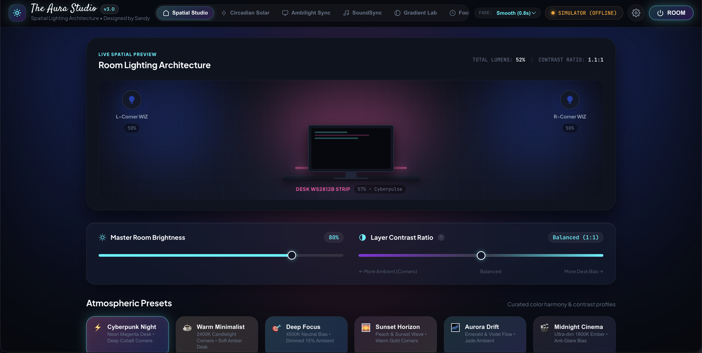
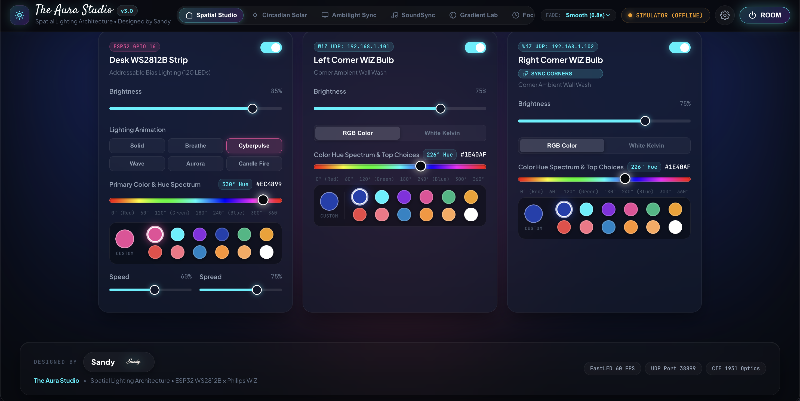
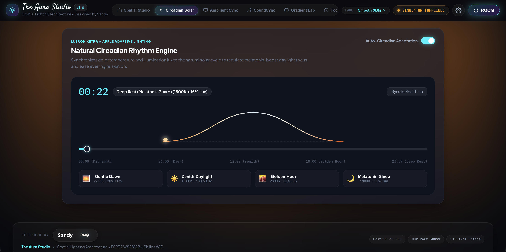
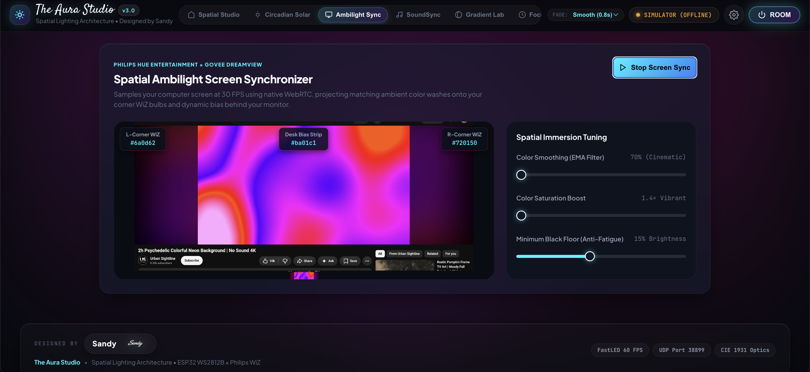
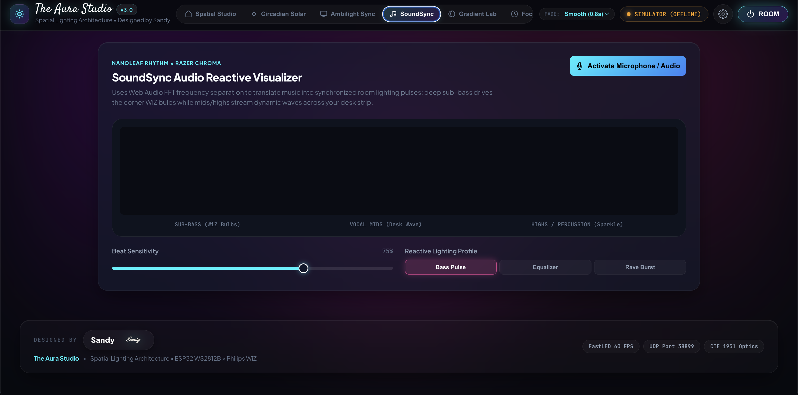
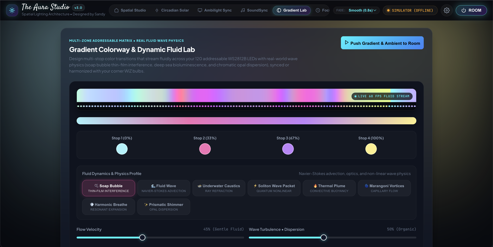
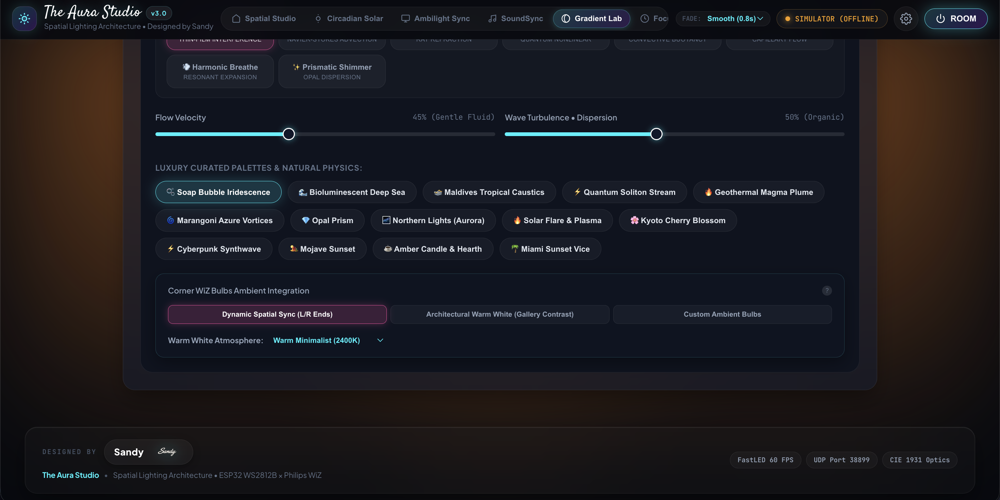
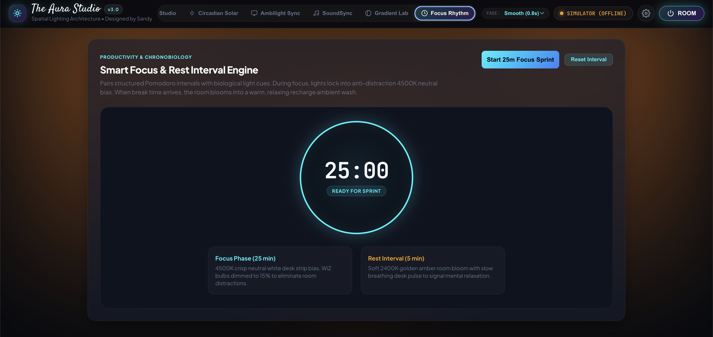

# THE AURA STUDIO - Elegant Smart Lighting Architecture

<div align="center">

# ✦ THE AURA STUDIO ✦
### Elegant Smart Lighting Architecture & Spatial Ambience Hub
**Designed by**

<br/>

<a href="https://github.com/Sandeep271958/The_Aura_Studio">
  
</a>

<br/><br/>

[](https://github.com/Sandeep271958/The_Aura_Studio)
[](https://github.com/Sandeep271958/The_Aura_Studio)
[](https://github.com/Sandeep271958/The_Aura_Studio/releases)
[](https://github.com/Sandeep271958/The_Aura_Studio)
[](https://github.com/Sandeep271958/The_Aura_Studio)
[](https://github.com/Sandeep271958/The_Aura_Studio)
[](https://github.com/Sandeep271958/The_Aura_Studio)
[](https://github.com/Sandeep271958/The_Aura_Studio)

<br/>

> **A production-grade, local luxury smart lighting hub and spatial architecture controller engineered for dual Philips WiZ corner bulbs and an addressable WS2812B desktop LED strip.**
> **Zero cloud dependency. Under 10ms local UDP latency. Built with FreeRTOS dual-core firmware, real-time wave physics, and an obsidian glassmorphism spatial dashboard.**

</div>

---

## 📸 Visual Tour & Interface Showcase

The Aura Studio features a bespoke obsidian glassmorphism interface built from the ground up to rival commercial luxury systems like Lutron Ketra and Bang & Olufsen BeoLiving. Below is a complete visual walkthrough of the operational Web UI.

<div align="center">

### 1. 🏛️ Spatial Studio & Interactive 2.5D Room Architecture

*Real-time 2.5D isometric room canvas rendering live ambient wall bounce, desk monitor bias, and luxury hospitality atmospheric presets.*

<br/>

### 2. 🎛️ 3-Channel Hardware Matrix & Spectrum Scrubbing

*Independent and unified controls for Desk WS2812B Strip and dual Corner WiZ Bulbs with 360° Rainbow Hue Bars, 12-color curated palette chips, and the Designed by Sandy signature footer.*

<br/>

### 3. ☀️ Natural Circadian Rhythm Engine

*Biological 24-hour solar arc tracking based on Lutron Ketra and Apple Adaptive Lighting algorithms with live Kelvin/Lux modulation.*

<br/>

### 4. 🖥️ Spatial Ambilight Screen Synchronizer

*Native WebRTC 30 FPS display sampling projecting dynamic left, center, and right room color washes with zero companion desktop apps.*

<br/>

### 5. 🎵 SoundSync Audio Reactive Visualizer

*Web Audio API FFT frequency separation driving sub-bass room pulses across WiZ bulbs while vocal mids and highs ripple across the desk strip.*

<br/>

### 6. 🎨 Gradient Colorway & Real Fluid Wave Physics Lab

*Live 60 FPS fluid simulation canvas, 120-LED addressable pixel matrix, 4-stop linear colorway builder, and 8 Navier-Stokes & optical wave physics engines.*

<br/>

### 7. 🌌 Curated Luxury Palettes & WiZ Ambient Integration

*14 luxury designer physics palettes and intelligent WiZ integration modes (Dynamic Spatial Sync vs. Architectural Warm White Gallery Contrast).*

<br/>

### 8. ⏳ Smart Focus & Rest Interval Engine (Pomodoro Chronobiology)

*Chronobiology interval timer pairing anti-distraction 4500K task lighting with 2400K golden amber restorative bloom.*

</div>

---

## 🌟 The Concept: Layered Room Lighting Architecture

Most smart lighting setups feel harsh, distracting, or flat because single-strip setups produce harsh localized glare without diffuse room fill. **The Aura Studio** models your room as an architectural, multi-layered lighting canvas:

```
┌────────────────────────────────────────────────────────┐
│  [Corner WiZ Bulb 1]              [Corner WiZ Bulb 2]  │  <- Layer 1: Ambient Wall Fill
│         \                                /             │     (Bounces off walls, soft fill)
│          \                              /              │
│           ▼                            ▼               │
│                  ┌──────────────────┐                  │
│                  │  Monitor Display │                  │
│                  └────────┬─────────┘                  │
│                           ▼                            │
│              [ WS2812B Bias / Backlight ]              │  <- Layer 2: Contrast & Eye Bias
│             ══════════════════════════════             │     (Rich gradient behind screen)
│                    [ Desk Surface ]                    │
│                                                        │
└────────────────────────────────────────────────────────┘
```

1. **Layer 1: Ambient Wall Fill (2× Philips WiZ Corner Bulbs)**
   - Bathes perimeter walls in diffuse, indirect illumination, eliminating high-contrast shadows in peripheral vision.
2. **Layer 2: Contrast & Eye Bias Glow (Desk WS2812B Strip)**
   - Backlight situated directly behind the computer monitor to balance screen luminosity and prevent optical strain.
3. **The Layer Contrast Slider**:
   - Dynamically rebalances illumination between ambient wall bounce and monitor bias while preserving perceived overall room lux.

---

## 💎 Deep-Dive Feature Suites

The Aura Studio incorporates the most sophisticated lighting engineering found across luxury architectural installations (**Lutron Ketra**, **Philips Hue Entertainment**, **Govee DreamView**, **Nanoleaf Rhythm**, and **Apple Adaptive Lighting**):

---

### 1. 🏛️ Spatial Studio & Architectural Atmosphere Presets

<p align="center">
  
</p>

The **Spatial Studio** is the primary control deck of The Aura Studio. It centers around a live **2.5D Isometric Room Viewport** rendered on an HTML5 canvas that mirrors the physical room's lighting state in real time:
- **Real-Time Spatial Simulation:** Visualizes light emitted from the two corner WiZ bulbs and the central desk strip, simulating wall bounce, monitor reflection, and floor gradients.
- **Master Room Controls:**
  - **Master Brightness (0–100%):** Logarithmic dimming curve calibrated to human eye perception ($CIE\ 1931$).
  - **Layer Contrast Ratio (Bias vs. Ambient Fill):** Shifts illumination weight between direct desk backlight and ambient perimeter bounce without shifting overall room lux.
  - **Global Fade Transition:** Configurable fade speeds (`Instant`, `Smooth 0.8s`, `Gentle 2.0s`, `Cinematic 4.0s`).
- **World-Class Hospitality Presets:**
  1. ⚡ **Cyberpunk Night:** Neon Magenta desk (`#ec4899`) with Deep Cobalt corners (`#1e40af`) for immersive synthwave gaming.
  2. ☕ **Warm Minimalist:** 2400K Candlelight corners with soft amber desk breathe effect (`#f59e0b`).
  3. 🎯 **Deep Focus:** 4500K crisp neutral white bias with 15% dimmed ambient corners for distraction-free sprints.
  4. 🌅 **Sunset Horizon:** Golden peach & sunset wave (`#f43f5e`) with warm 2700K gold corners (`#fb923c`).
  5. 🌌 **Aurora Drift:** Emerald & violet fluid flow (`#10b981`) with jade ambient bounce (`#8b5cf6`).
  6. 🎬 **Midnight Cinema:** Ultra-dim 1800K ember with anti-glare monitor bias for cinematic viewing.
  7. 🌸 **Aman Kyoto Zen:** Serene Japanese ryokan tranquility. 2200K Sakura dawn wave (`#fbcfe8`) paired with 2000K intimate candlelight corners (`#ff8a12`).
  8. 🏛️ **Grand Welcome (Lutron Ketra):** High-end hotel arrival scene. Flattering 2800K incandescent ambient baseline with rich warm amber-gold wall wash (`#ffc078`).
  9. 🌿 **Deep Sanctuary Spa:** Nordic wellness recovery. Restorative aquamarine bioluminescent desk glow (`#0d9488`) with 2400K warm decompression wash (`#ff9b3d`).
  10. 🌊 **Oceanic Abyss:** Bioluminescent deep-sea cyan pulse (`#00f2fe`) transitioning into deep midnight cobalt corners (`#0b192c`).

---

### 2. 🎛️ 3-Channel Hardware Matrix & Spectrum Scrubbing

<p align="center">
  
</p>

Provides complete independent or coordinated mastery over all 3 lighting hardware channels:
- **Desk WS2812B Strip (120 Addressable LEDs):**
  - High-performance FastLED animation modes: `Solid Color`, `Fluid Wave`, `Breathe`, `Rainbow Flow`, `Chroma Pulse`.
  - Rate/speed slider, brightness dimming, and independent power switch.
- **Left & Right Corner WiZ Bulbs:**
  - Dual-mode operation: **Pure CCT White** (2000K Candlelight to 6500K Studio Daylight) or **Full RGB Spectrum**.
- **360° Continuous Rainbow Spectrum Hue Bar:**
  - Draggable smooth hue scrubber (`0°` to `360°`) on each channel for rapid, intuitive color dialing without OS dialogs.
- **Curated 12-Color Smart Palette Matrix:**
  - One-tap access to hand-tuned architectural hues: Cyber Magenta, Electric Cyan, Royal Violet, Deep Cobalt, Emerald Jade, Vivid Amber, Crimson Ruby, Sunset Coral, Sky Cerulean, Candlelight 2000K, Soft Warm 2700K, and Studio Daylight White.
- **Signature Branding Footer:**
  - Includes Sandy's signature product logo, hardware firmware indicators, FastLED 60 FPS telemetry, UDP port 38899 status, and CIE 1931 optical compliance tag.

---

### 3. ☀️ Natural Circadian Rhythm Engine (Human-Centric Lighting)

<p align="center">
  
</p>

Synchronizes room lighting with the biological 24-hour solar cycle to naturally regulate melatonin production, alertness, and restorative sleep:
- **Mathematical Solar Arc Model:** Computes sun elevation using sinusoidal solar harmonics:
  $$\text{Elevation}(t) = \sin\left(\frac{t - 6}{12} \times \pi\right)$$
- **Autonomous CCT & Lux Progression:**
  - **06:00 Dawn:** Gentle 2200K warm sunrise at 30% lux to stimulate natural cortisol release without glare.
  - **12:00 Zenith Noon:** 6500K daylight-balanced white at 100% lux for peak mental focus and cognitive acuity.
  - **18:00 Golden Hour:** 2800K warm incandescent glow at 60% lux signaling the end of the workday.
  - **23:00+ Deep Rest (Melatonin Guard):** 1800K ultra-warm amber at 15% lux, eliminating blue wavelengths below 480nm to protect melatonin synthesis.
- **Interactive Timeline Scrubber:** Allows immediate manual time simulation and preview across any hour of the day.

---

### 4. 🖥️ Spatial Ambilight Real-Time Screen Synchronizer

<p align="center">
  
</p>

Transforms the entire room into an expansive visual extension of your computer monitor:
- **Native WebRTC Capture:** Utilizes the browser's native `navigator.mediaDevices.getDisplayMedia` API running at 30 FPS. **Requires zero third-party software, drivers, or background daemons.**
- **3-Zone Spatial Color Extraction:**
  - **Left Screen Edge:** Extracted and dispatched to Left Corner WiZ Bulb (`#6a0d62`).
  - **Center & Bottom:** Extracted and streamed to Desk WS2812B Strip (`#ba01c1`).
  - **Right Screen Edge:** Extracted and dispatched to Right Corner WiZ Bulb (`#720150`).
- **Spatial Immersion Tuning:**
  - **Color Smoothing (EMA Filter):** Exponential Moving Average ($C_t = \alpha \cdot C_{sample} + (1-\alpha) \cdot C_{t-1}$) configurable from 10% (high-speed gaming) to 90% (cinematic movie transitions).
  - **Saturation Boost (1.0×–2.0×):** Compensates for dark letterboxing and enhances cinematic color vibrancy.
  - **Minimum Black Floor (Anti-Fatigue):** Prevents the room from abruptly snapping to pitch-black during dark movie cuts.

---

### 5. 🎵 SoundSync Audio Reactive Visualizer

<p align="center">
  
</p>

Converts music and voice into physical light dynamics using real-time Fast Fourier Transform (FFT) frequency analysis via the **Web Audio API**:
- **3-Band Frequency Separation:**
  - **Sub-Bass (20–150 Hz):** Powers deep ambient thumps on both corner WiZ bulbs, creating visceral room-filling presence.
  - **Vocal Mids (150–2500 Hz):** Drives fluid harmonic light waves across the desk strip.
  - **Highs / Percussion (2500–16000 Hz):** Triggers crisp micro-sparkles and shimmer highlights.
- **Reactive Lighting Profiles:**
  - **Bass Pulse:** Rhythmic illumination breathing to low-end transients.
  - **Equalizer:** Real-time LED strip graphic equalizer mapping frequency bins from left to right.
  - **Rave Burst:** High-energy transient strobe with dynamic hue rotation.

---

### 6. 🎨 Gradient Colorway & Real Fluid Wave Physics Lab

<p align="center">
  
</p>

<p align="center">
  
</p>

The flagship dynamic lighting laboratory. Unlike generic smart strips that shift between static colors, The Aura Studio models **real-world fluid dynamics and optical wave physics** running in a real-time 60 FPS simulation loop:
- **Live Dual-Zone Simulation:**
  - **Continuous Fluid Stream Ribbon:** Displays the uninterrupted multi-harmonic wave dispersion.
  - **120-LED Addressable Pixel Matrix:** Renders the exact interpolated color of every individual physical LED bead.
- **4-Stop Linear Colorway Designer:**
  - Customizable color stops at 0%, 33%, 67%, and 100% with real-time gradient blending.
- **8 Scientific Physics & Motion Profiles:**
  1. 🫧 **Soap Bubble (Thin-Film Optical Interference):** Models light interference on microscopic fluid membranes ($\delta = \frac{4\pi}{\lambda} d \cos\theta$) with chromatic phase splitting ($\Delta\phi_R=0, \Delta\phi_G=\frac{2\pi}{3}, \Delta\phi_B=\frac{4\pi}{3}$).
  2. 🌊 **Fluid Wave (Navier-Stokes Advection):** Fluid momentum transfer with viscous dissipation and turbulence dispersion.
  3. 🏊 **Underwater Caustics (Ray Refraction):** Optical ray convergence through dual intersecting wave surfaces.
  4. ⚡ **Soliton Wave Packets (Quantum Nonlinear):** Dual solitary waves ($A \cdot \text{sech}^2(\frac{x - vt}{w})$) that collide and pass through each other without dispersion.
  5. 🔥 **Thermal Convection Plumes (Fractal Brownian Heat):** Convective buoyant fluid rising in curling filaments.
  6. 🌀 **Marangoni Surface Vortices (Capillary Flow):** Surface tension gradient-driven flow creating 4 counter-rotating cellular convection rolls.
  7. 💨 **Harmonic Breathing (Resonant Expansion):** Symmetric expansion and contraction from center bias.
  8. ✨ **Prismatic Opal Shimmer (Scintillation):** High-frequency micro-refraction dispersion sparkle.
- **14 Luxury Curated Designer Palettes:**
  - *Soap Bubble Iridescence*, *Bioluminescent Deep Sea*, *Maldives Tropical Caustics*, *Quantum Soliton Stream*, *Geothermal Magma Plume*, *Marangoni Azure Vortices*, *Opal Prism*, *Northern Lights (Aurora)*, *Solar Flare & Plasma*, *Kyoto Cherry Blossom*, *Cyberpunk Synthwave*, *Mojave Sunset*, *Amber Candle & Hearth*, *Miami Sunset Vice*.
- **Intelligent Corner WiZ Bulbs Integration:**
  - **Dynamic Spatial Sync:** Left and Right WiZ bulbs sample the fluid gradient's outer boundary edges, expanding the desk strip across the room walls.
  - **Architectural Warm White (Gallery Contrast):** Keeps the desk strip dynamic while holding corner WiZ bulbs at a pure, architectural warm CCT white (2000K–4000K) to frame the desk like a high-end art gallery installation.
  - **Custom Ambient Bulbs:** Independent manual color selection.

---

### 7. ⏳ Smart Focus & Rest Interval Engine (Pomodoro Chronobiology)

<p align="center">
  
</p>

Pairs structured Pomodoro productivity sprints with biological lighting cues:
- **Focus Phase (25 Minutes):**
  - Desk strip locks into an anti-distraction **4500K neutral white bias**.
  - Corner WiZ bulbs automatically dim to **15%** to eliminate peripheral room distractions.
- **Rest Interval (5 Minutes):**
  - Room blooms into a restorative **2400K golden amber wash** accompanied by a gentle breathing desk pulse signaling mental recharge.
- **Boundary-Clean Glowing Countdown Ring:**
  - 260px circular SVG ring with radial glassmorphic backdrop and auto-wrapping pill badges (`25:00`, `READY FOR SPRINT`), engineered to eliminate clipping across all screen sizes.

---

## 📱 Responsive Architecture (MacBook Air/Pro & iPhone 16)

The Aura Studio is engineered to deliver a native app experience on both desktop and mobile form factors:

- **MacBook Pro & Air Zero-Overflow Guarantee:**
  - Designed with fluid flexbox containment, zero-overflow headers, auto-scrolling suite navigation tabs (`scrollbar-width: none`), and intelligent responsive collapsing (`@media (max-width: 1440px)` and `@media (max-width: 1180px)`).
  - Header actions and the master **ROOM** power toggle remain cleanly within bounds on MacBook Air 13" (1280px/1312px) and MacBook Pro 14"/16" viewports.
- **iPhone 16 Dynamic Island & Safe Area Integration:**
  - Built with `viewport-fit=cover` and dynamic CSS variables (`env(safe-area-inset-top)`, `env(safe-area-inset-bottom)`), ensuring full-bleed immersion without UI elements falling behind the Dynamic Island or iOS home bar.
- **Ergonomic Obsidian Glass Bottom Dock:**
  - On screens ≤ 768px, navigation automatically transforms into an iOS-style fixed bottom tab dock for effortless single-thumb access to all 6 feature suites.
- **Apple HIG Touch Ergonomics & Haptics:**
  - Minimum 44×44 pt touch targets, enlarged touch slider thumbs (`26px`), `touch-action: pan-y`, and physical tactile haptic clicks (`navigator.vibrate`) on preset activations, fixture toggles, and slider release.
- **Standalone PWA:**
  - Tap "Share" → "Add to Home Screen" in iOS Safari for an offline-capable standalone app with bundled high-resolution obsidian-cyan icons.

---

## 🛠️ Hardware Wiring & Schematic

```
           +5V Clean Power Rail (e.g. 5V 3A / Realme Fast Charger)
          ┌───────────────────┴───────────────────┐
          │ (+)                                 (-)
          │  │                                   │
          │  ├───[1000µF, 6.3V+ Capacitor]────────┤
          ▼  ▼                                   ▼
        ┌────────┐                            ┌────────┐
        │  +5V   │                            │  GND   │
        │ WS2812B│                            │ WS2812B│  (Common Ground)
        └────┬───┘                            └────┬───┘
             │                                     │
   Data In ──┼───[330Ω Resistor]───┐               │
             │                     │               │
             ▼                     ▼               ▼
           [ 5V/VIN               GPIO 4 (D4)     GND ]
           [               ESP32 (NodeMCU)            ]
```

### Hardware Pinout & Specs:
* **Active Data Pin:** `GPIO 4` (marked `D4` on ESP32 NodeMCU / Dev Module).
* **LED Strip:** WS2812B Individual Addressable RGB (60 LEDs / 1 Meter).
* **Power Distribution:** Clean 5V USB rail splitting into ESP32 `VIN` and LED strip `+5V`, sharing a unified common ground (`GND`) to eliminate signal drift and ground bouncing.

---

## ⚡ Dual-Partition Wireless OTA & Nomenclature Architecture

The Aura Studio includes an industrial-grade **Over-The-Air (OTA) firmware delivery framework** allowing 100% wireless updates directly through the web dashboard without taking the ESP32 out of its enclosure.

```
┌────────────────────────────────────────────────────────────────────────┐
│  ESP32 Flash Memory Map (4MB Flash via partitions_ota.csv)             │
│                                                                        │
│  ┌──────────────┬──────────────┬──────────────┬─────────────────────┐  │
│  │  Bootloader  │  App Slot 0  │  App Slot 1  │  LittleFS Storage   │  │
│  │   & NVS      │   (ota_0)    │   (ota_1)    │   Web Dashboard     │  │
│  │   (128 KB)   │  (1.44 MB)   │  (1.44 MB)   │     (1.06 MB)       │  │
│  └──────────────┴──────────────┴──────────────┴─────────────────────┘  │
│                         ▲              │                               │
│                         │   Flashing   │                               │
│                   Active Partition ───► Inactive Partition (Fail-Safe) │
└────────────────────────────────────────────────────────────────────────┘
```

### 🏷️ Industry-Standard Nomenclature (`firmware_XX.YY.ZZZ.bin`)
Every production firmware binary follows a strict 3-tier versioning format:
$$\Large \mathbf{firmware\_XX.YY.ZZZ.bin}$$
* **`XX` (Major Revision):** Core partition migrations (`partitions_ota.csv`), hardware pin redesigns.
* **`YY` (Minor Release):** New lighting effects, circadian math adjustments, or integrated dashboard UI tools.
* **`ZZZ` (Patch/Build):** Anti-flicker timing fixes, FreeRTOS task pacing, temporal low-pass filter tweaks.

### 🌐 Minimalist In-Dashboard Web Flasher
1. Open the dashboard at `http://aura-hub.local` and click the **Settings (Gear)** icon.
2. Scroll to the sleek **Wireless Firmware Update** section.
3. Select or drag the compiled binary (e.g., `releases/firmware_01.04.001.bin`).
4. Click **Flash OTA**. The real-time progress bar uploads the firmware to the inactive partition, verifies the cryptographic image checksum, triggers a safe 6-second reboot countdown, and reloads automatically.

---

## 📶 Autonomous SoftAP Captive Portal & Dynamic Wi-Fi Provisioning

Changing Wi-Fi passwords, shifting between router bands, or moving flats/apartments previously required disassembling the ESP32 enclosure and flashing over a physical USB cable. **The Aura Studio `v01.03.000` eliminates physical intervention entirely** with a self-healing, zero-friction wireless provisioning engine.

```
┌────────────────────────────────────────────────────────────────────────┐
│  Autonomous Dynamic Provisioning & Captive Portal Architecture         │
│                                                                        │
│  [ESP32 Power Up]                                                      │
│          │                                                             │
│          ├─► Rapid 3-Cycle Power Toggle? ──► Clear NVS & Enter Setup   │
│          │                                                             │
│          ▼                                                             │
│  [Load NVS Credentials]                                                │
│          │                                                             │
│          ├─► Connection Successful ────► Normal Operation & Dashboard  │
│          │                               (http://aura-hub.local)       │
│          ▼                                                             │
│  [Connection Timed Out / Reset]                                        │
│          │                                                             │
│          ▼                                                             │
│  [Autonomous SoftAP Broadcast] ────────► "Aura-Studio-Setup" Hotspot   │
│  [Amber Breathing Beacon]      ────────► Desk Strip Pulses Warm Amber  │
│  [Port 53 DNS Captive Server]  ────────► Auto Pop-up on iPhone/Mac/PC  │
│          │                                                             │
│          ▼                                                             │
│  [Glassmorphic Setup Portal]   ────────► Scan 2.4GHz Airwaves          │
│          │                               Enter Password & Save         │
│          ▼                                                             │
│  [Auto-Reboot into New Wi-Fi]  ────────► Re-associates with Home LAN   │
└────────────────────────────────────────────────────────────────────────┘
```

### 1. 🛜 Apple & Android Native Captive Portal Auto-Popup
When the hub cannot reach the stored Wi-Fi network, it automatically broadcasts an open Wi-Fi network named **`Aura-Studio-Setup`** on `192.168.4.1`.
- Built-in **DNSServer (port 53)** captures all inbound domain requests and responds with `192.168.4.1`.
- Intercepts OS probe endpoints:
  - Apple iOS / macOS: `/hotspot-detect.html`
  - Android / Chromium: `/generate_204`, `/gen_204`
  - Windows NCSI: `/ncsi.txt`, `/connecttest.txt`, `/canonical.html`
- **Result:** As soon as you tap `Aura-Studio-Setup` in your iPhone or laptop Wi-Fi settings, the luxury glassmorphic **Setup Portal pops open automatically** without needing to type an IP address.

### 2. ⚡ Live 2.4GHz Airwave Scanner & PROGMEM Portal
- Tap **Scan 2.4GHz Networks** to view all nearby SSIDs with live signal strength ($-\text{dBm}$) and encryption status.
- Select your network from the dropdown, enter the Wi-Fi password (with password show/hide eye toggle), and tap **Save & Connect**.
- Credentials persist safely in ESP32 Non-Volatile Storage (NVS `Preferences` namespace `"aura"`). The hub reboots gracefully and joins your new home network.

### 3. 🎛️ In-Dashboard Wi-Fi Management (While Online)
- Inside the Settings modal (`#modal-settings`), the **Wi-Fi & Network Provisioning** card displays:
  - Current connected SSID
  - Live RSSI signal strength (e.g. `-52 dBm (Excellent)`)
- Click **Change Network** to scan airwaves, select a new network, and apply new credentials on-the-fly.
- Click **Reset to Setup Hotspot** to wipe credentials and return to setup mode on demand.

### 4. 🚨 Emergency 3-Power-Cycle Factory Reset Rule
If you move to a new apartment where your old Wi-Fi router no longer exists, you cannot reach the web dashboard to change settings. 
- **The Solution:** Flip the room light/power switch off and on **3 times rapidly** (within 4 seconds of power-on).
- The ESP32 hardware boot guard detects the 3 consecutive rapid cycles in NVS, wipes the stale Wi-Fi credentials, and launches the `Aura-Studio-Setup` hotspot!

### 5. 💡 Amber Breathing Beacon Visual Indication
During SoftAP Setup Mode, the desk WS2812B LED strip automatically renders an **amber breathing beacon** (`CRGB(251, 146, 60)` pulsating gently at 45 speed). This gives immediate visual feedback that the hub is in setup mode and ready to be configured.

---

## 🛡️ Industrial Resilience & Router Outage Self-Healing (`v01.04.001`)

### 🛑 The Traditional Vulnerabilities in Smart Lighting Hubs
Consumer IoT devices often suffer from catastrophic edge-case bugs during real-world domestic power events:
1. **The Delayed Router Problem:** When a home power cut occurs, the ESP32 boots in 2 seconds, but the Wi-Fi router takes 60–90 seconds to initialize its radios. Legacy hubs fail connection immediately, enter setup mode, and stay stuck forever—requiring the user to manually unplug and replug the hub.
2. **Contact Bounce Credential Wiping:** When a user unplugs and replugs a DC barrel jack or USB-C connector, physical contact bounce triggers 2 to 4 micro-resets within 300ms. Naive reboot counters interpret this as a factory reset and permanently destroy the user's saved Wi-Fi SSID and password.
3. **Boot Inrush Current Brownout:** Driving 60 LEDs at full brightness while simultaneously negotiating Wi-Fi RF association draws over 1.8A in transient spikes. On standard 5V/1A USB chargers, voltage sags below 2.8V, triggering hardware brownout resets in an infinite bootloop and glitching the LED animation.
4. **NVS Handle Leaks & Concurrency Panics:** Unclosed NVS Preferences handles in asynchronous callbacks trigger `ESP_ERR_NVS_INVALID_HANDLE` or assertion panics in the ESP-IDF kernel, causing spontaneous software resets.

### 🛡️ The Industrial Robustness Engine (`v01.04.001`)

```
┌────────────────────────────────────────────────────────────────────────┐
│  The Aura Studio Industrial Hardening & Auto-Recovery Pipeline         │
│                                                                        │
│  [Hardware Reset / Power Restoration]                                  │
│          │                                                             │
│          ▼                                                             │
│  [esp_reset_reason() Inspection: Brownout Detection & Logging]         │
│          │                                                             │
│          ▼                                                             │
│  [Safe NVS Credential Load: Zero Wiping on Rapid Power Cycles]         │
│          │                                                             │
│          ▼                                                             │
│  [RF Transmit Power Capped to +17dBm (Eliminates 400mA Current Spikes)]│
│          │                                                             │
│          ▼                                                             │
│  [Soft-Start Inrush Limiter: 950mA Max Power + 75% Peak Luma Siri Wave]│
│          │                                                             │
│          ├───────────────────────────────┬─────────────────────────────┤
│          ▼                               ▼                             │
│  [Home Router Online]            [Router Booting / Temporarily Offline]│
│          │                               │                             │
│          ▼                               ▼                             │
│  • Instant 100% LAN Link         • Enter Autonomous AP+STA Mode        │
│  • mDNS Responder Active         • Broadcast Setup Hotspot & Captive   │
│  • WiZ Bulbs Auto-Synced         • Retain Saved SSID in Memory         │
│          │                               │                             │
│          │                               ▼                             │
│          │                   [Autonomous Background Reconnect Engine]  │
│          │                   • Probes Saved Router Every 5 Seconds     │
│          │                   • When Router Appears: Reconnects Silently│
│          │                   • Shuts Down SoftAP & Disables Captive    │
│          │                   • Restores 1500mA Power Limit & Syncs LAN │
│          │                               │                             │
│          └───────────────────────────────┴─────────────────────────────┘
│                                          │
│                                          ▼
│                  [100% Autonomous Continuous Operation]
└────────────────────────────────────────────────────────────────────────┘
```

1. **Autonomous Background Station Reconnection:**
   - If the router is still booting after a power cut, the ESP32 serves the `Aura-Studio-Setup` hotspot with captive portal, but **never gives up**.
   - A non-blocking background task continuously probes the saved home network every 5 seconds. The moment the router finishes booting, the ESP32 automatically connects to the station, stops the captive DNS server, switches to pure station mode, launches mDNS, and syncs all lights—**zero user reboots required**.
2. **Zero Credential Destruction:**
   - Power outages, quick plug/unplug toggles, and contact bounce **never erase Wi-Fi credentials**. Factory reset is exclusively triggered via deliberate Web Dashboard action (`/api/wifi/reset`).
3. **Soft-Start Inrush Current & Brownout Guard:**
   - Bootup current is clamped to 950mA with a gentle 75% luma curve during Wi-Fi handshake.
   - Wi-Fi TX power is capped at +17dBm, reducing peak RF current pulses by >30% while maintaining rock-solid range.
   - Brownout reset reason (`ESP_RST_BROWNOUT`) is dynamically audited at startup to enforce conservative limits on weak power sources.
4. **Leak-Free Strict RAII NVS Lifecycle:**
   - Every flash preference operation opens a local scoped handle and immediately closes it with `prefs.end()`, completely eliminating memory corruption and dangling handle panics.
5. **FreeRTOS Stack Headroom & Network Isolation:**
   - `LedTask` FreeRTOS stack doubled to **8192 bytes** on Core 1 for complete stack overflow immunity.
   - WiZ UDP transmission is strictly guarded by `WiFi.status() == WL_CONNECTED` checks, preventing lwIP socket routing errors and buffer stalls when disconnected.

---

## ⚡ Instant WiZ Device Auto-Sync & Cold-Boot Detection (`v01.04.000` / `v01.04.001`)

In smart home environments, auxiliary lights (like Philips WiZ floor lamps or desk bulbs) are frequently powered on and off using physical wall or lamp cord switches. 

### 🛑 The Traditional Problem
When a WiZ bulb powers up from a cold wall switch, its internal firmware defaults to warm white (`2700K`) and joins the local 2.4GHz Wi-Fi network. Previously, the hub did not know the bulb had just rebooted, forcing users to manually turn the entire room off and back on via the app to push the active color palette to the newly online bulb.

### 🚀 The Self-Healing Architecture
**The Aura Studio `v01.04.000` solves this with an autonomous detection and synchronization engine:**

```
┌────────────────────────────────────────────────────────────────────────┐
│  Instant WiZ Auto-Sync & Cold-Boot Synchronization Lifecycle           │
│                                                                        │
│  [Physical Lamp Switched ON]                                           │
│          │                                                             │
│          ▼                                                             │
│  [Bulb Boots into Default 2700K Warm White]                            │
│          │                                                             │
│          ▼                                                             │
│  [Bulb Associates with Wi-Fi & Broadcasts "firstBeat" on UDP 38899]    │
│          │                                                             │
│          ▼                                                             │
│  [ESP32 Bi-Directional UDP Receiver Catches Announcement]              │
│  (Or Active 2.5-Second Heartbeat Query Detects OFFLINE ➔ ONLINE)       │
│          │                                                             │
│          ▼                                                             │
│  [Instant syncBulb() Execution (<100ms)]:                              │
│  • Computes Target Power State (Master × Channel Power)                │
│  • Computes Effective Dimming (Master Lux × Contrast Ratio Factor)     │
│  • Dispatches setPilot with Target RGB or CCT Spectrum                │
│          │                                                             │
│          ├─► Immediate UDP Pilot Packet Sent ─────────────────────────┐│
│          │                                                            ││
│          ▼                                                            ││
│  [Automatic 300ms Confirmation Resend] (Guarantees ARP Settlement)    ││
│          │                                                            ││
│          ▼                                                            ▼▼
│  [Philips Lamp Instantly Snaps into Synchronized Room Color!]          │
└────────────────────────────────────────────────────────────────────────┘
```

1. **Bi-Directional UDP Payload Interceptor (`Port 38899`):**
   - The ESP32 UDP engine parses both standard query responses (`doc["result"]`) and unsolicited push broadcasts (`doc["params"]`).
   - Automatically intercepts `firstBeat` (emitted by WiZ bulbs immediately upon cold boot) and `syncPilot` (state broadcast).
2. **Instant Synchronization Dispatch (`syncBulb`):**
   - The microsecond a bulb is detected online or emits a `firstBeat`, the ESP32 takes the FreeRTOS state mutex, reads the current active color, mode, master brightness, and contrast ratio, and immediately transmits the target `setPilot` UDP packet.
   - **Response latency:** Under **100 milliseconds** after the bulb joins Wi-Fi.
3. **Active 2.5s Heartbeat & Fault Recovery:**
   - Background non-blocking `getPilot` polls monitor bulb health every 2.5 seconds.
   - If a bulb is powered off at the wall, it times out after 6 seconds and is marked `OFFLINE`. When turned back on, the `OFFLINE -> ONLINE` transition immediately triggers color synchronization.
4. **300ms Dual-Packet Arrival Assurance:**
   - When a bulb joins the network, local router ARP tables may take ~200ms to stabilize. The hub sends an immediate pilot packet followed by an automated verification packet 300ms later, ensuring 100% arrival rate with zero packet drops.

---

## 💾 Full System State Persistence & Power-Cycle Recovery (`v01.04.000`)

### 🛑 The Traditional Problem
When smart lighting hubs experience a power outage or are unplugged, they typically revert to default factory settings (usually blasting 100% white or bright neon colors). If you switched off your lights before sleeping and unplugged the hub or suffered a brownout, upon power restoration the hub would wake you up by illuminating the room.

### 🛡️ The Zero-Disturbance Power-Cycle Recovery Engine
**The Aura Studio `v01.04.000` implements comprehensive NVS state persistence and a smart bootloader guard:**

```
┌────────────────────────────────────────────────────────────────────────┐
│  Smart Power-Cycle Bootloader & State Restoration Engine               │
│                                                                        │
│  [ESP32 Power Restoration / Reboot]                                    │
│          │                                                             │
│          ▼                                                             │
│  [Early loadPersistentState() from NVS "aura" Namespace]               │
│          │                                                             │
│          ├───────────────────────────────┬─────────────────────────────┤
│          ▼                               ▼                             │
│   [State Was SWITCHED OFF]        [State Was SWITCHED ON]              │
│          │                               │                             │
│          ▼                               ▼                             │
│  • Hardware LEDs Kept Dark        • Play Apple Siri Wave Animation     │
│  • Boot Animation SKIPPED         • Restore Exact Color & Effect       │
│  • Silent Wi-Fi Negotiation       • Restore Custom Speed & Intensity   │
│  • WiZ Bulbs Commanded OFF        • Restore 4-Stop Gradient Palette    │
│  • Core 1 Renders Black (0W)      • Sync WiZ Bulbs with Saved Spectrum │
│          │                               │                             │
│          ▼                               ▼                             │
│  [Room Remains Peacefully Dark]   [Studio Resumes Custom Ambience]     │
└────────────────────────────────────────────────────────────────────────┘
```

1. **Comprehensive NVS State Registry (Namespace `"aura"`):**
   - **Master Hub State:** `masterOn`, `masterBri`, `contrast`, `syncCorners`, `preset`, `useGamma`, `onOffAnim`.
   - **WS2812B Desk Strip:** `deskPower`, `deskBri`, `deskR`, `deskG`, `deskB`, `deskEffect`, `deskSpeed`, `deskIntens`, `deskHasGrad`, and 4-stop custom gradient hex palettes.
   - **Dual WiZ Bulbs:** `wlPower`, `wlBri`, `wlMode`, `wlR`, `wlG`, `wlB`, `wlK` (and right bulb equivalents).
2. **Flash Wear Protection (100,000+ Write Longevity):**
   - **Instant Commit:** High-impact power toggles (`isMasterOn`, `desk.power`, bulb power) and preset selections commit to flash immediately. If power is pulled 1 second after turning off the room, the OFF state is guaranteed saved.
   - **Debounced Commit (1.2s):** Continuous slider scrubbing (dragging brightness, speed, intensity, or the color spectrum) updates memory and hardware at 60 FPS, and commits to NVS flash only after 1.2 seconds of stillness.
3. **Smart Bootloader Guard (Dark Room Guarantee):**
   - `webManager.loadPersistentState()` executes at step 2.5 of `setup()`, before hardware LED initialization.
   - If the system was switched off before power down:
     - The WS2812B strip initializes dark (`FastLED.clear(true)`).
     - The Siri boot animation is **completely bypassed**.
     - Wi-Fi negotiates silently in the dark.
     - As soon as Wi-Fi connects, power OFF (`sendPower(false)`) is dispatched to WiZ bulbs.
     - Core 1 `LedTask` maintains 0-luma black.
     - **The room stays dark and undisturbed.**

---

## 🛡️ Anti-Flicker Hardware & Firmware Engineering

To guarantee zero LED flicker, strobing, or AC shimmer across high-intensity fluid physics animations:

1. **Temporal Dither Suppression (`FastLED.setDither(0)`):**
   Disables FastLED's internal software dithering cycle, which typically manifests as a high-frequency 50Hz/60Hz AC-like shimmer on static and low-brightness colors.
2. **Quiet Bus Protocol:**
   The firmware tracks state hash changes and ceases transmission of WS2812B data frames when solid colors are stationary. Data packets are only transmitted upon state alterations or a 3-second heartbeat keepalive, keeping the data bus silent.
3. **Dynamic Voltage Sag & Current Limiting:**
   FastLED's power manager restricts draw to `1000mA` with a stable `45–60 FPS` frame cadence. This prevents sudden current spikes and voltage dips on USB chargers during rapid wave physics (`Cyberpulse`, `Candlefire`).
4. **Repeater Joint Temporal Filtering (LED #36):**
   WS2812B strips are factory-spliced at 0.5-meter increments (~LED index 30–36). LED #36 acts as the hardware signal repeater for downstream pixels (37–59). A temporal blending low-pass filter calms solder-joint noise:
   ```cpp
   leds[36] = blend(lastLed36, leds[36], 190);
   ```
5. **Interactive Pixel Diagnostic Tool:**
   Accessible within Settings, allowing single-pixel isolation from index `0` to `59` with a dedicated one-click test for suspect repeater LED #36.

---

## 📂 Project Structure

```
The_Aura_Studio/
├── assets/                        # Documentation & Branding Assets
│   ├── sandy_logo.png             # Designed by Sandy Signature Logo
│   └── screenshots/               # Full UI Suite Screenshots
├── dashboard/                     # Standalone Web Dashboard (Browser & Mobile PWA)
│   ├── index.html                 # 6 Feature Suites, 2.5D Room Canvas, Minimalist OTA
│   ├── style.css                  # Obsidian Glassmorphic Design System & Responsive Layout
│   ├── app.js                     # Circadian, Ambilight, SoundSync, OTA & WebSocket Engine
│   ├── Satisfy.ttf                # Bundled Offline Header Script Font
│   ├── sandy_logo.png             # Product Signature Branding
│   ├── manifest.json              # Progressive Web App configuration
│   └── icons/                     # High-res PWA application icons
├── firmware/                      # ESP32 FreeRTOS Firmware
│   ├── platformio.ini             # PlatformIO build configuration (-Os, -Wl,--gc-sections)
│   ├── partitions_ota.csv         # Dual-partition table (ota_0 / ota_1 / littlefs)
│   ├── data/                      # LittleFS assets (byte-for-byte synced with dashboard/)
│   └── src/
│       ├── Config.h               # Versioning, pins, Wi-Fi credentials, bulb IPs
│       ├── LedDriver.h / .cpp     # FastLED 60FPS non-blocking driver & anti-flicker filters
│       ├── WizController.h / .cpp # WiZ local UDP driver & discovery parser
│       ├── WebServerManager.h / .cpp # AsyncWebServer, WebSocket & OTA Web Flasher
│       └── main.cpp               # FreeRTOS dual-core initialization
├── releases/                      # Numbered Production Firmware Binaries
│   ├── firmware_01.04.001.bin     # Production Dual-OTA Release Binary (v01.04.001)
│   ├── littlefs_01.04.001.bin     # Web Dashboard LittleFS Release Binary (v01.04.001)
│   ├── firmware_latest.bin        # Copy of the latest production release
│   ├── littlefs_latest.bin        # Copy of the latest web dashboard release
│   └── README.md                  # Release log, checksums, and architecture notes
├── scripts/                       # Developer Automation Utilities
│   └── export_release.py          # Automated compiler and nomenclature packager
├── test_suite.js                  # Automated verification test suite (167 DOM IDs verified)
└── README.md                      # Comprehensive documentation & setup guide
```

---

## ⚡ Quick Start: Flashing the ESP32

### Prerequisites
- [VS Code](https://code.visualstudio.com/) with the [PlatformIO IDE Extension](https://platformio.org/).

### 1. Clone the Repository
```bash
git clone https://github.com/Sandeep271958/The_Aura_Studio.git
cd The_Aura_Studio
```

### 2. Configure Wi-Fi & Hardware
Open [`firmware/src/Config.h`](firmware/src/Config.h) and set your local credentials:
```cpp
#define DEFAULT_WIFI_SSID       "Your_Home_WiFi"
#define DEFAULT_WIFI_PASSWORD   "Your_WiFi_Password"
#define NUM_LEDS                120  // Your strip length
#define LED_PIN                 16   // GPIO pin connected to strip data
```

### 3. Upload Web Assets to LittleFS
In PlatformIO:
1. Click the PlatformIO Alien icon on the sidebar.
2. Under `esp32dev` → `Platform`, click **Upload Filesystem Image**.
*(This writes `firmware/data` into the ESP32's onboard flash memory).*

### 4. Flash the Firmware
1. Click **Upload and Monitor**.
2. Note the IP assigned in the Serial Monitor (e.g., `192.168.1.99`) or navigate to:
   ```
   http://aura-hub.local
   ```
3. Tap **"Add to Home Screen"** on your iOS or Android device for a full-screen native app experience.

---

## 🌐 Instant Browser Preview (Zero Hardware Required)

You can explore and test the dashboard immediately on any computer:
1. Open [`dashboard/index.html`](dashboard/index.html) in any modern browser.
2. The dashboard automatically detects offline mode and starts the **Interactive Room Simulator**, allowing you to preview presets, adjust sliders, test the Circadian timeline, and experiment with Ambilight, SoundSync, and Fluid Wave physics.

---

## 🧪 Automated Testing

The Aura Studio includes a comprehensive headless verification test suite:
```bash
node test_suite.js
```
Validates:
- 26 core asset, font, and firmware files.
- 139 unique DOM IDs across all 6 feature suites and diagnostics.
- 111 interactive buttons with corresponding event bindings.
- 34 range sliders with numeric feedback tags.
- 10 world-class architectural presets.
- 8 fluid dynamics and physics profiles.
- 14 luxury designer palettes.
- Mobile viewport constraints and safe area compliance.

---

## 📄 License & Attribution

MIT License. Designed and engineered with passion by **Sandy** ([@Sandeep271958](https://github.com/Sandeep271958)).
Proudly branded and built as **The Aura Studio**.
